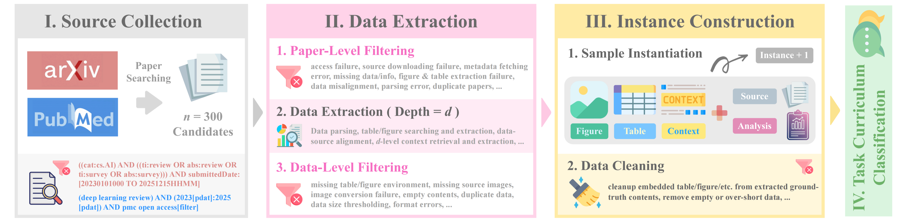

# **ANAGENT For Enhancing Scientific Table & Figure Analysis**

<div align="center">

[](https://xhguo7.github.io/Anagent/)
&nbsp;&nbsp;
[](https://arxiv.org/abs/2602.10081)
&nbsp;&nbsp;
[](https://arxiv.org/pdf/2602.10081)
&nbsp;&nbsp;
[](https://github.com/xhguo7/Anagent)
&nbsp;&nbsp;
[](https://huggingface.co/datasets/AI4Research/AnaBench)

</div>

---

## 📊 **ANABENCH: Benchmarking Scientific Table & Figure Analysis**

**ANABENCH** is a large-scale benchmark featuring **63,178 instances** from **9 scientific domains** and **170 fine-grained subdomains**, systematically categorized along **7 complexity dimensions** to evaluate scientific table and figure analysis capabilities.

<div align="center">

</div>

### **Key Features**

- **📈 63,178 Instances** across diverse scientific domains
- **🔬 9 Broad Domains**: Computer Science, Electrical Engineering, Mathematics, Physics, Economics, Quantitative Biology, Quantitative Finance, Statistics, Biomedicine
- **🎯 170 Fine-grained Subdomains** for more comprehensive coverage
- **📐 7 Complexity Dimensions**: Type, Domain, Format, Source, Width, Depth, Objective

### **Complexity Dimensions**

1. **Type**: Tables, figures, or combined multimodal contents
2. **Domain**: 9 broad scientific fields with 170 fine-grained subdomains
3. **Format**: LaTeX, XML, and other representations
4. **Source**: General research papers vs. review & survey papers
5. **Width**: Self-contained, internal, external, or mixed reference scope
6. **Depth**: Shallow description vs. in-depth inferential analysis
7. **Objective**: Methodology-oriented vs. experiment-oriented analysis

---

## 🌟 **ANAGENT: Multi-Agent Collaborative Scientific Analysis**

**ANAGENT** is a multi-agent framework that simulates human research workflows through four specialized agents working collaboratively to perform high-quality scientific table and figure analysis.

<div align="center">

</div>

### **Specialized Agents**

- **🎯 PLANNER**: Decomposes complex tasks into actionable subtasks and provide task-oriented planning guidance
- **🔍 EXPERT**: Performs iterative knowledge acquisition through specialized tool execution and targeted retrieval
- **🖋️ SOLVER**: Synthesizes accumulated knowledge to generate coherent, context-aware analysis solutions
- **🔧 CRITIC**: Assesses analysis quality through five-dimensional evaluation and provides targeted refinement feedback

---

## 🛠️ **1. Environment Setup**

### **Installation**

```bash
git clone https://github.com/xhguo7/Anagent.git
cd Anagent

conda env create -f environment.yml
conda activate anagent
```


### **Optional Components**

```bash
pip install -e ".[docker]"      # Docker sandbox backend
pip install -e ".[docx]"        # .docx / .doc input
pip install -e ".[html2pdf]"    # HTML-to-PDF conversion
```

OCR additionally requires the Tesseract binary on `PATH` (`conda install -c conda-forge tesseract`).

### **Dataset**

Download [ANABENCH](https://huggingface.co/datasets/AI4Research/AnaBench) and place it under `dataset/anabench/`:

```bash
huggingface-cli download AI4Research/AnaBench --repo-type dataset --local-dir dataset/anabench
```

### **Credentials**

Keys are read at runtime from `~/.anagent_keys`, one file per credential. Override the location with `KEY_DIR`.

```bash
mkdir -p ~/.anagent_keys
echo "<your-key>" > ~/.anagent_keys/openai_api_key
```

- **`openai_api_key`**: OpenAI models
- **`azure_api_key`**: Azure-hosted models
- **`google_api_key`**, **`google_cse_id`**: web search tool
- **`hf_hub_token`**: gated HuggingFace models

---

## 🌟 **2. ANAGENT for Scientific Table & Figure Analysis**

```bash
bash scripts/run_anagent.sh \
    --mode batch \
    --test-data dataset/anabench/test.json \
    --output-dir ./anagent_output
```

A single instance:

```bash
bash scripts/run_anagent.sh \
    --mode single \
    --query "<your query>" \
    --image <path/to/figure.png>
```

Frequently used options — run `bash scripts/run_anagent.sh --help` for the full list:

- **`--planner-model`**, **`--expert-model`**, **`--solver-model`**, **`--critic-model`**: model for each agent
- **`--expert-turns <n>`**: Expert retrieval turns
- **`--critic-turns <n>`**: Solver-Critic refinement rounds (`0` disables the Critic)
- **`--enable-tools <list>`**: tools available to the Expert
- **`--max-samples <n>`**: cap the number of instances
- **`--seed <int>`**: random seed

---

## 🌟 **3. Evaluation**

Rule-based metrics:

```bash
bash scripts/run_eval.sh --infer-output <path>/batch_results.json
```

LLM-as-judge:

```bash
bash scripts/run_judge_eval.sh --json-path <path>/batch_results.json
```

The two evaluations are reported separately.

---

## 📝 Citation

Thanks much for your interests!

If you find our work useful, please kindly cite:

```bibtex
@inproceedings{guo-etal-2026-anabench,
    title = "{A}na{B}ench for Enhancing Scientific Table {\&} Figure Analysis",
    author = "Guo, Xuehang  and  Lu, Zhiyong  and  Hope, Tom  and  Wang, Qingyun",
    booktitle = "Proceedings of the 2026 Conference on Empirical Methods in Natural Language Processing",
    month = oct,
    year = "2026",
    address = "Budapest, Hungary",
    publisher = "Association for Computational Linguistics",
    url = "https://aclanthology.org/2026.emnlp-main.1454/",
    doi = "10.18653/2026.emnlp-main.1454",
    pages = "33199--33269",
    ISBN = "979-8-89176-459-0"
}
```

---

<div align="center">

🥰 Thanks much for your interest!

</div>